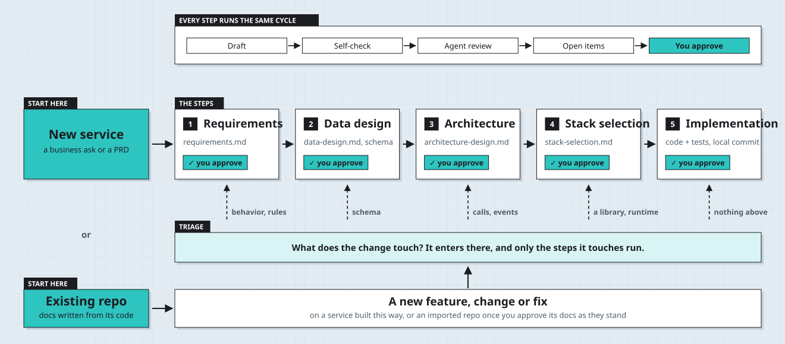

# backend-skills

Agent skills for building backend services from requirements. Each skill is a plain-Markdown `SKILL.md` in the open
[Agent Skills](https://agentskills.io) format, usable from Claude Code, GitHub Copilot, Cursor, Codex, Antigravity CLI
and any other agent that reads it.

What these skills add, compared with asking an agent without them:

- **A design process with checkpoints.** Requirements, data design, architecture and stack choice are separate
  documents with stable ids, and a person reviews each one before the next step starts and before any code is
  written.
- **Decisions that stay decided.** Approved decisions are protected: a later phase that wants to change one has to
  say so and ask, instead of quietly drifting.
- **Documents that agree with each other.** A consistency pass checks the documents against each other before
  implementation starts, and each review gate can be rendered into one HTML page for the person approving it.



## Demo

One agent ran the whole chain from a five-line business ask: the design documents for each phase, then a Python
service built in three reviewed slices, with its tests.

- **[Open the design review page](https://si1verwind17.github.io/backend-skills/demo/)**: the rendered review a
  person reads at a gate, one tab per step, with the decisions owed at each.
- [The design documents](demo/parking-reservation/docs/backend-design/): requirements, data design, architecture,
  stack selection and open items, as the agents read them.
- [The demo](demo/parking-reservation/README.md): the ask, how the run was made, the service and its tests, and
  what its own grading found.

## Install

**Claude Code**

```
/plugin marketplace add si1verwind17/backend-skills
/plugin install backend-development@backend-skills
```

**GitHub Copilot, Cursor, Codex, Antigravity CLI and others,** via GitHub CLI:

```
gh skill install si1verwind17/backend-skills
```

**Anything else:** copy the `skills/<name>/` directories into your agent's skills folder.

No prerequisites for the skills themselves. `rendering-design-docs` needs Node 18 or later to render its page.

## Skills

- [`building-backend-services`](skills/building-backend-services/SKILL.md): orchestrates the whole chain
  (requirements, data design, architecture, stack selection, implementation) as phases with a human review gate
  between each.
- [`writing-business-requirements`](skills/writing-business-requirements/SKILL.md): turns a fuzzy business ask or
  an existing PRD into structured requirements with stable ids, locked decisions and owner-assigned open questions.
- [`backend-design-by-data`](skills/backend-design-by-data/SKILL.md): designs the data layer from the requirements:
  tables or documents, DDL, constraints and indexes, idempotent and atomic write paths, schema evolution.
- [`backend-architecture`](skills/backend-architecture/SKILL.md): draws service boundaries, decides where state
  lives, sync versus async interactions, events and topics, caching, and serverless versus Kubernetes.
- [`backend-stack-selection`](skills/backend-stack-selection/SKILL.md): chooses or validates language, framework and
  runtime against the team's existing stack, the deployment target and library maturity.
- [`backend-code-conventions`](skills/backend-code-conventions/SKILL.md): language-neutral conventions for service
  code: layers, business versus technical logic, error handling, logging, naming, unit and integration tests.
- [`rendering-design-docs`](skills/rendering-design-docs/SKILL.md): renders a design-document set into one HTML page
  for a human review gate; agents keep reading the Markdown.

## Use

Start the whole flow, from requirements to implementation, by running the orchestrator by name:

```
/backend-development:building-backend-services
```

That is its name when installed as the Claude Code plugin; copied into a skills folder it is
`/building-backend-services`. It runs each step in order (requirements, data design, architecture, stack selection,
implementation), stops for your approval at every gate, and calls the other skills as it goes. Or ask in plain words:

> Build a backend service from this business ask, with a review gate after each phase.

> Add refunds to this service.

> Import this existing repo so we can change it the same way.

The other skills also work on their own, for example:

> Turn this PRD into structured requirements before we design anything.

> Render docs/backend-design into a single review page.

## License

MIT, see [`LICENSE`](LICENSE).
