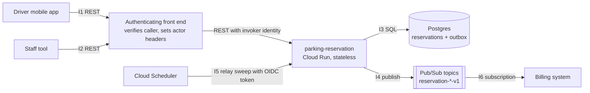
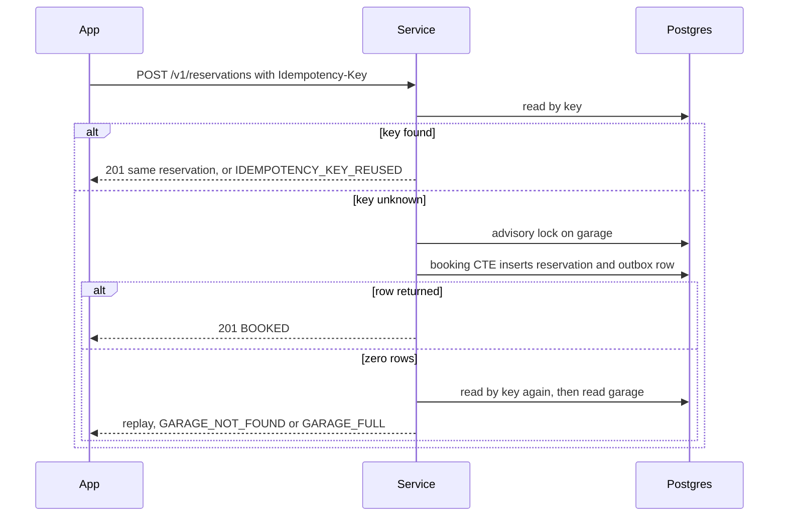
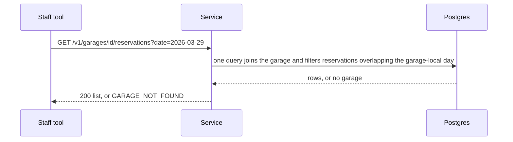
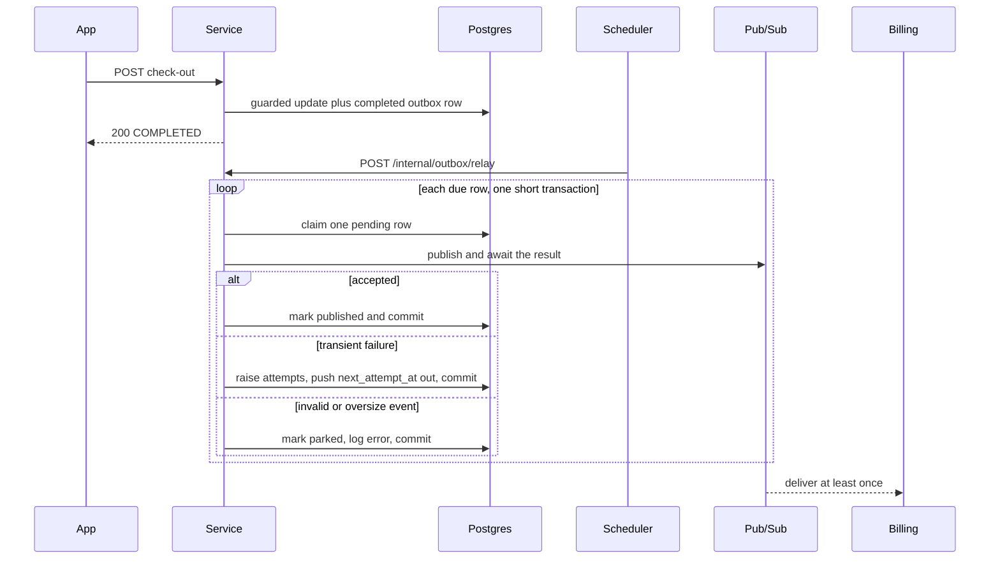

# Architecture: parking-reservation
Status: REVIEWED · 2026-11-23
Form: built
Builds on: requirements.md (LD1–LD4, UC1–UC7, R1, R13–R18, R21, NF1–NF4), data-design.md (E4, W1–W5, DD5, DD8, DD12)

One stateless service on Cloud Run owns all reservation data in its Postgres database. Clients reach it through an authenticating front end over REST. Every state change leaves an event in the service's own outbox table; a scheduled sweep publishes the events to a topic per transition, and billing consumes the completion topic.

## Components

## Key flows

## Decisions
| Id | Decision | By | Why | Beat | Serves |
|---|---|---|---|---|---|
| AD1 | One service, `parking-reservation`, owning its database | agent | one team, one capability, POC-sized volume (NF2); a split adds hops without a boundary to defend | separate reservation and billing-feed services | LD1, NF2 |
| AD2 | Stateless; no in-process mutable state; Postgres is the only state (a time-bounded cache of Google's public signing keys is derived read-only data, not service state) | agent | scale-out on Cloud Run; serialization lives in the database (DD5) | per-reservation actor | R1, LD2 |
| AD3 | No cache of business data (AD2 notes the one derived exception) | agent | reads are indexed lookups at NF2 volume; staleness could show a taken spot | cached day lists | NF3 |
| AD4 | Cloud Run with request-based CPU, minimum instances 0 (assumed — OI-15), maximum 10, request concurrency 10, pool of 5 connections per instance, a 5 s wait for a pooled connection, 5 s lock and statement timeouts | agent | scale-to-zero assumed acceptable; the cap, the pool and the timeouts bound database load, and a request waiting on DD5's lock holds one pooled connection; Cloud SQL needs `max_connections` of at least 120 to cover two revisions of 50 connections during a rollout plus the loader, migrations and reserved connections; the first request after idle or a scale-out pays a cold start, so it may exceed NF3, and the minute sweep keeps an instance warm in practice, not by guarantee | minimum 1 instance (always-on cost) | LD2, NF3 |
| AD5 | REST with JSON for every client call; no gRPC | agent | front-facing mobile clients | gRPC | LD4 |
| AD6 | Callers reach the service only through an authenticating front end that verifies the driver's or staff member's credential, removes any client-supplied `X-Actor-Id` and `X-Actor-Role`, sets them from the verified identity, and sends its own Google ID token in `Authorization`; Cloud Run requires IAM authentication with invoker granted on this service only to the front end's and the scheduler's service accounts; the service itself verifies the ID token of every call (audience, issuer, expiry), accepts `/v1/*` only from the front end's account and `/internal/*` only from the scheduler's, and rejects every other path, with one exception: `GET /health` is answered without a token and without a caller check, because Cloud Run's own probe reaches the container with no token and the endpoint returns no data; for `/v1/*` it then checks role and ownership (R13, R17, R21) from the headers (assumed — OI-6) | agent | the headers are trusted because the service verifies who sent them, not because of network position; this also closes the project-Editor and scheduler paths to `/v1/*`; preconditions: the service runs as its own dedicated service account, no invoker grant at project level, impersonation of the two accounts is restricted to operators | trusting headers on IAM alone | R13, R17, R21 |
| AD7 | Events are published by a sweep: Cloud Scheduler calls `POST /internal/outbox/relay` every minute (assumed — OI-19); the service verifies the call's ID token as AD6 states; no publish in the request path; the sweep takes at most 50 due rows, publishes each with a 10 s timeout, stops claiming new rows once one row's worst case of 25 s would pass 45 s, holds one pooled connection at a time, and backs a failing row off by `min(30 s × 2^attempts, 15 min)`, alerting at 10 attempts | agent | a request never depends on the broker; Cloud Run allocates CPU only during requests, so work after a response is not reliable; the bounds keep a sweep inside one tick | publish inline after commit | R14, UC6 |
| AD8 | One topic per transition: `reservation-reserved-v1`, `reservation-checked-in-v1`, `reservation-completed-v1`, `reservation-cancelled-v1`; JSON payloads; a breaking change means a `-v2` topic | agent | every transition is published by default (DD12); billing subscribes only to completed | one topic with a type field | UC6, R14 |
| AD9 | Pub/Sub as the broker, delivery at least once, consumers deduplicate on `event_id` (assumed — OI-1); billing's subscription on `reservation-completed-v1` must exist before the first completion is published, and the subscription's retention bounds how long billing may be down (default 7 days) | agent | GCP-native for Cloud Run; the outbox already makes duplicates possible; Pub/Sub keeps a message only for subscriptions that exist at publish time | self-run broker | UC6 AC1, UC6 AC2 |
| AD10 | A published or parked row can be re-driven: an operator sets its outbox row back to `pending` with `published_at` cleared, `attempts` reset to 0 and `next_attempt_at` now, and the next sweep publishes it again | agent | a loss behind the broker (subscription missing, retention exceeded) needs a recovery path; consumers deduplicate on `event_id` | no recovery path | NF1, UC6 AC2 |

UC6 AC2 ("a billing outage loses nothing") therefore holds while billing's outage is shorter than its subscription's retention, and beyond that through AD10.

## Interactions
| Id | From → to | Style, protocol | Failure path |
|---|---|---|---|
| I1 | app → front end → service | sync REST | the client repeats the same request: reserve is idempotent by key (R18), transitions answer from stored state (DD8); a technical failure returns 503 |
| I2 | staff tool → front end → service | sync REST | read only, the client repeats |
| I3 | service → Postgres | sync SQL over a pool | a failed statement is an error to the caller; one bounded retry of a transient connection error on read paths only, never around a write; the client repeats failed writes, which are idempotent |
| I4 | service → Pub/Sub | async publish by the sweep, one short transaction per row, awaiting each publish result before marking the row | a transient failure leaves the row `pending` with `attempts` raised and `next_attempt_at` set out by AD7's backoff; a row at 10 attempts is logged as an error on every sweep for an operator; only an invalid or oversize event is parked, with an error log, and re-driven by AD10; topic- or permission-level errors are transient plus that alert; one row never blocks the rest |
| I5 | Scheduler → service | sync HTTP call every minute | the next tick; overlapping sweeps claim different rows with `SKIP LOCKED`, and a crash between publish and mark can publish a row twice, which consumers absorb by `event_id` |
| I6 | Pub/Sub → billing | async, at least once; push or pull is billing's choice | redelivery by the broker; billing owns its dead-letter handling |

The worst-case delay of a completion notice is one tick plus the sweep's drain, about two minutes in normal operation (assumed — OI-20), and up to the 15-minute backoff cap after a broker outage ends.

## API inventory
The routes built so far are in `src/parking_reservation/api/` (`*_routes.py`), and FastAPI generates the OpenAPI document from them (`app.openapi()`); `GET /health` is Cloud Run's probe. Errors are JSON `{code, message}` with the codes of `domain/errors.py`; status values on the wire are `BOOKED`, `CHECKED_IN`, `COMPLETED`, `CANCELLED`. The sweep endpoint `POST /internal/outbox/relay` is for Cloud Scheduler only (AD6, AD7). The staff lookup takes the date as the query parameter `date`, in `YYYY-MM-DD`.

## Event catalog
All four events share one payload; fields not yet true at that transition are null.

| Id | Topic | Triggered by | Consumers |
|---|---|---|---|
| EV1 | `reservation-reserved-v1` | W1 | none yet |
| EV2 | `reservation-checked-in-v1` | W2 | none yet |
| EV3 | `reservation-completed-v1` | W3 | billing (R14) |
| EV4 | `reservation-cancelled-v1` | W4 | none yet |

| Field | Source |
|---|---|
| `event_id` | `outbox.event_id` |
| `event_type` | `outbox.event_type` |
| `occurred_at` | derived: the service clock's value at the transition, equal to `reservation.updated_at` after it |
| `reservation_id` | `reservation.public_id` |
| `driver_id` | `reservation.driver_id` |
| `garage_id` | `reservation.garage_id` |
| `spot_id` | `reservation.spot_id` |
| `window_start`, `window_end` | `reservation.window_start`, `reservation.window_end` |
| `checked_in_at` | `reservation.checked_in_at` |
| `checked_out_at` | `reservation.checked_out_at` |
| `cancelled_at` | `reservation.cancelled_at` |

PII note: `driver_id` is an opaque identifier, the only personal-data field (NF4, OI-13); no name, contact or plate is in any payload. A consumer subscribing later receives no history unless a subscription or topic retention exists; the outbox rows allow re-driving (AD10). Versioning: breaking changes publish to a `-v2` topic beside the old one.

## Scaling notes
At NF2 volume one instance suffices. Per-garage serialization (DD5) queues requests for the same garage, each holding one of its instance's 5 connections; the 5 s lock timeout turns a long wait into a 503 the client repeats. Ten instances of 5 connections bound the service at 50 connections per revision. The sweep takes at most 50 rows per call; a backlog drains over successive ticks.
