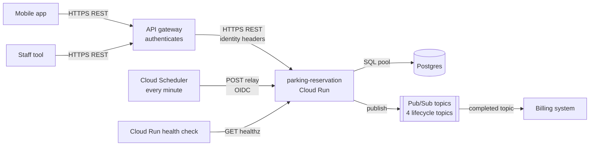
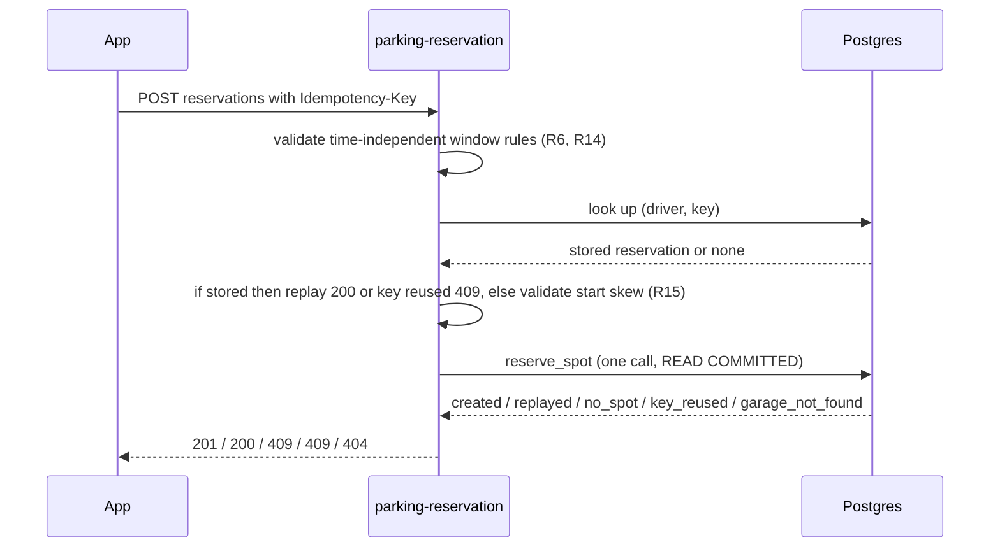
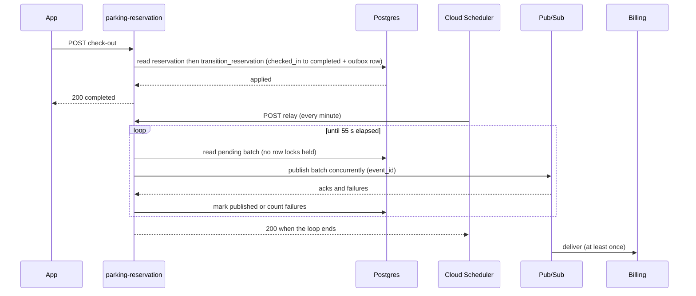

# Architecture design: parking-reservation
Status: APPROVED · 2026-10-17 · approved by user (review gates waived for this run)
Form: built
Builds on: requirements.md (UC1–UC6, R9, NF1–NF6, LD1–LD3), data-design.md (W1–W5, DD2, DD4, DD5, DD6, DD9, A1–A7)

One stateless Python service on Cloud Run holds the whole API and the outbox relay. Postgres arbitrates every concurrent write. Lifecycle events leave through a transactional outbox; a relay that Cloud Scheduler starts every minute and that polls for 55 seconds publishes them, so billing hears of every completion at least once, with a dedup id.

## Components







## Decisions

| Id | Decision | Why | Beat | Serves |
|---|---|---|---|---|
| AD1 | One service holds the API and the relay (service split: OI-19) | Team of 4, one database, one deploy unit; relay shares the outbox code | Separate relay service: a second deployable for 30 lines of loop | LD1, DD5 |
| AD2 | Stateless: no in-process mutable state; all state in Postgres | Scale horizontally, scale on Cloud Run; races arbitrated by data design guards | In-memory spot cache: stale, wrong with several instances | R1, DD2 |
| AD3 | No cache | Hottest read is the staff lookup, low frequency; garage lookup is by indexed code inside the call | Cache garages: no measured need | NF2, A6 |
| AD4 | Cloud Run, min-instances 1, max-instances 10 and request concurrency 20 per instance, sized so peak instances (up to twice the maximum) × pool size stays under 60 % of the database connection limit (proposed — OI-20) | Avoid cold starts on the user-facing path for 99.9 % (NF4), protect Postgres connections | Scale to zero: cold-start latency on the first call of the day | NF3, NF4, LD1 |
| AD5 | REST + JSON, versioned path `/v1`; no gRPC | Front-facing mobile traffic | gRPC: needs a proxy for browsers, no benefit here | LD2 |
| AD6 | Authentication is done upstream by an API gateway (AD13). Cloud Run requires IAM authentication and only the gateway's and the scheduler's service accounts hold the invoker role. The service reads the caller's identity only from the gateway's verified-claims header (configured header name, JSON claims, `sub` = driver id, a `role` claim = `staff` for staff — claim names OI-5) and never from client-controllable headers such as `X-Driver-Id`. `/internal/relay` verifies in the service that the caller's ID token has the scheduler account's email and this service's audience. Every driver operation filters by the caller's driver id, and an identity with the staff role is refused on driver operations (OI-21) | The verified-claims header is set by the gateway from the validated token, so a client cannot choose its identity. Google API Gateway forwards other client headers unchanged, so a service that trusted `X-Driver-Id` would be forgeable | Verify end-user tokens in-service: needs an issuer and keys nobody gave us | R12, OI-5 |
| AD7 | Events are published by an outbox relay: Cloud Scheduler calls `POST /internal/relay` every minute and the handler runs a publish loop for 55 s, doing all work before it responds | Cloud Run throttles CPU outside requests, so work must live inside the request. Polling inside the 55 s loop makes the delay a few seconds, which meets the 1-minute NF6; the minute re-start is the repair for a crashed run | Stop when empty: worst case over a minute by construction. Inline publish after commit: crash or throttle loses the event | R9, NF1, NF6, DD5 |
| AD8 | Relay iteration: read up to 50 pending events (fewest attempts first, then oldest) without holding row locks, skipping rows that already failed during this run, publish them concurrently with a 10 s deadline each, then in one short transaction mark acknowledged rows `published` and, for failed rows, record the error and add one attempt, both updates guarded on `status = 'pending'`. A row is retried at most once per run, so one attempt is at least a minute apart from the next (runs start each minute) and a row parks after 60 failed runs (proposed — OI-18). When no row is eligible the loop sleeps 2 s. Two overlapping runs may publish the same event twice, which at-least-once delivery and the `event_id` dedup absorb | No transaction spans network calls, a short broker outage cannot exhaust the attempts, a failing row costs one overlapped deadline, and the guard stops a late failure from touching a row another run already published | Row locks held across publishes: the transaction would outlive the cap and roll back attempt counts. Counting an attempt per iteration: a brief outage parks everything | NF6, DD5 |
| AD9 | At-least-once delivery, dedup by `event_id` on the consumer (OI-8); no ordering guarantee across events | Matches NF1 and billing only needs `completed` | Exactly-once: not offered by the broker end to end | R9, NF1 |
| AD10 | Domain validation and state-machine rules live in the service's domain layer, the database holds the guards | Pure, unit-testable rules | Rules in SQL functions only | UC1–UC5 |
| AD11 | Staff may read any garage's reservations (staff scoping: OI-21) | No role model was given | Per-garage staff grants: unspecified | R13, UC2 |
| AD12 | Pub/Sub, one topic per lifecycle event. The billing team owns and creates the subscription on the completed topic, with no expiry, before go-live, and with a dead-letter topic and an alert. Every topic retains messages for 7 days (proposed — OI-8) | Cloud Run is on GCP; a subscription only receives messages published after it exists, and an unconsumed topic simply drops them, so the subscription is a go-live precondition and retention allows a replay seek | Direct HTTP call to billing: couples request-time availability to billing | R9, NF1, OI-8, OI-9 |
| AD13 | API gateway product: Google Cloud API Gateway or the organization's existing gateway (OI-5), forwarding the verified token claims in a header (for Google API Gateway `X-Apigateway-Api-Userinfo`) | The service must not hold token-verification keys | Verify tokens in-service | OI-5, R12 |

## Interactions

| Id | Interaction | Sync / async, protocol | Failure path |
|---|---|---|---|
| I0 | App or staff tool → gateway → service | Sync, REST via the gateway | Gateway rejects unauthenticated calls with 401 before the service sees them. A gateway→service failure surfaces as 502/503 to the client, who retries; every endpoint is safe to retry (idempotent by key or by state) |
| I1 | Mobile app → service (UC1, UC3–UC6) | Sync, REST | App retries; create is idempotent by key, transitions are idempotent by state. A database error mid-call returns `503` and the retry is safe |
| I2 | Staff tool → service (UC2) | Sync, REST | Plain retry; read only |
| I3 | Service → Postgres | Sync, SQL, pooled | No in-process retry loops; one bounded retry for SQLSTATE 23505/23P01 from `reserve_spot` (idempotent, W1); other database failures return `503 UNAVAILABLE` and the client retries |
| I4 | Scheduler → relay endpoint | Scheduled HTTPS POST + OIDC, the handler works until done | A missed or failed call is repaired by the next minute's call. Alerts (proposed — OI-22): oldest pending event older than 5 minutes, and any event parked. A parked event is re-queued by an operator setting `status = 'pending'` and `attempts = 0` on its row once the cause is fixed |
| I7 | Cloud Run → `/healthz` | Sync probe | Failing probe restarts the instance |
| I5 | Relay → Pub/Sub | Sync publish, concurrent per batch, 10 s deadline each | Failure adds an attempt and records `last_error` on that row only (AD8), the next iteration retries it; after the allowed failed runs the row is `parked` and logged at error level (OI-18). A poison event costs one overlapped deadline and sorts behind fresh events, so it blocks no one |
| I6 | Pub/Sub → billing | Async, broker redelivery | Billing's side: the broker redelivers until acked, billing dedups on `event_id`, a message that keeps failing goes to billing's dead-letter topic and alerts (AD12, OI-8). Delivery is unordered, so one failing message blocks no other |

## API inventory

Routes are in `src/parking_reservation/api/*_router.py`, and the OpenAPI document is generated by the running service (`/openapi.json`). What the code cannot say: `POST /v1/reservations` requires header `Idempotency-Key` and answers 201 created or 200 replayed; `POST /internal/relay` runs the relay for 55 s and responds only when done (never return early and keep working: Cloud Run would throttle it), so the Cloud Run request timeout and the Scheduler attempt deadline must be at least 90 s (a run lasts at most about 75 s and overlaps the next one; worst case 55 s loop + 10 s publish deadline + 4 s pool waits + a 5 s certificate fetch, about 75 s). The run's request line carries `published`, `failed`, `parked` and `oldest_pending_age_seconds`, the gauge of the I4 alerts. Errors share one JSON body `{code, message}`; codes and statuses are `api/error_status.py` (`INVALID_REQUEST` and `INVALID_WINDOW` 422, `IDEMPOTENCY_KEY_REUSED`, `NO_SPOT_AVAILABLE`, `INVALID_TRANSITION`, `CHECKIN_WINDOW_CLOSED` 409, `GARAGE_NOT_FOUND`, `RESERVATION_NOT_FOUND` 404, `UNAUTHENTICATED` 401, `FORBIDDEN` 403, `UNAVAILABLE` 503, `INTERNAL_ERROR` 500 for a defect; unknown routes and methods answer `HTTP_<status>` in the same body). Any database error is a retryable 503, and a defect is logged once and answered as 500, both by the request boundary (`api/error_handlers.py`, `api/request_logging.py`).

## Event catalog

All four events share one payload built in the database by `reservation_event_payload` (DD6); the outbox row stores it as published. Topics follow `parking-reservation-<event>-v1`; breaking changes go to a `-v2` topic (OI-9, OI-8).

| Id | Topic | Trigger (write path) | Consumers |
|---|---|---|---|
| EV1 | `parking-reservation-reserved-v1` | W1 created | none yet |
| EV2 | `parking-reservation-checked-in-v1` | W2 applied | none yet |
| EV3 | `parking-reservation-completed-v1` | W3 applied | billing (OI-8) |
| EV4 | `parking-reservation-cancelled-v1` | W4 applied | none yet |

Payload fields and their source:

| Field | Source |
|---|---|
| `event_id` | `outbox_event.event_id` (dedup id) |
| `topic` | `outbox_event.topic` |
| `occurred_at` | writer's clock at the transition (derived, same instant as `updated_at`) |
| `reservation_public_id` | `reservation.public_id` |
| `status` | `reservation.status` after the transition |
| `driver_id` | `reservation.driver_id` |
| `garage_code` | `garage.code` |
| `spot_label` | `spot.label` |
| `start_at`, `end_at` | `reservation.start_at`, `reservation.end_at` |
| `checked_in_at`, `checked_out_at`, `cancelled_at` | same-named `reservation` columns (null when not reached) |

All timestamps are ISO-8601 UTC strings (the database session time zone is pinned to UTC). PII note: `driver_id` is an opaque external identifier, no name, plate or payment data (NF5, OI-17). Billing prices the stay from the window and the check-in/out instants; no price field exists (pricing is out of scope, requirements §9).

Example (EV3):

```json
{"event_id": "0193f2c4-7a10-7c2e-9b1d-3f6a2e8d5c01", "topic": "parking-reservation-completed-v1",
 "occurred_at": "2026-10-20T11:00:00Z", "reservation_public_id": "0193f2c1-0b3e-7f4a-8d52-1c9e6a7b4d20",
 "status": "completed", "driver_id": "drv_8842", "garage_code": "HBF-01", "spot_label": "A12",
 "start_at": "2026-10-20T10:00:00Z", "end_at": "2026-10-20T12:00:00Z",
 "checked_in_at": "2026-10-20T10:05:00Z", "checked_out_at": "2026-10-20T11:00:00Z", "cancelled_at": null}
```

## Scaling notes

NF2 sizing (≤ 20 writes/s, about 1,200 events/min at peak, at most 3 per reservation) is a single Postgres instance and a handful of Cloud Run instances. Creates serialize per garage on a row lock (DD4), so contention exists only inside one garage. The relay publishes 50 events per iteration concurrently, so one iteration takes roughly one publish round trip (tens of milliseconds) and the loop handles thousands of events per minute. The relay request keeps one instance busy 55 s of every minute, so scale-to-zero never happens in practice and min-instances 1 costs nothing extra (AD4). Revisit min-instances and pool size with measured load (OI-20, OI-10).
