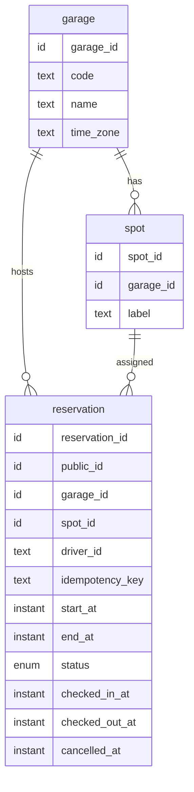

# Data design: parking-reservation
Status: APPROVED · 2026-10-17 · approved by user (review gates waived for this run)
Form: built
Builds on: requirements.md (UC1–UC6, R1–R20, NF1, NF2, NF5, NF6, LD1–LD3)

Garages own spots; a reservation claims one spot for a half-open time window and moves through a four-state lifecycle. Double-booking is prevented by the database itself, not by application checks. Every state change records a lifecycle event in the same transaction, so billing is told of each completion without a second system being written in the request.

## Logical model

| Entity | Meaning, id semantics, invariants |
|---|---|
| E1 garage | Seeded outside the API (§9). `garage_id` global sequence, internal; `code` is the external, unique identifier. `time_zone` is an IANA name; the lookup day is the garage-local date (R18). |
| E2 spot | `spot_id` global sequence; `label` unique per garage (numbering restarts per garage). Spots are never deleted in v1. |
| E3 reservation | `reservation_id` global sequence, internal only. `public_id` is a UUIDv7 and the only id clients see (DD3). Window `[start_at, end_at)` is half-open (R19) and `end_at > start_at` (R6). Lifecycle `reserved → checked_in → completed`, `reserved → cancelled` (UC3–UC5, R7, R8, R11). A reservation in `reserved`, `checked_in` or `completed` holds its window; `cancelled` does not (R2, R3, R17, R20). `(driver_id, idempotency_key)` is unique (R10). `driver_id` is an opaque string, no FK, since drivers live in another system (NF5). |

Technical tables outside the logical model, described under the physical model: `outbox_event` and `schema_migration`.

## Access patterns

| Id | Access | By | Frequency | Serves |
|---|---|---|---|---|
| A1 | List a garage's reservations overlapping a day | garage + time range, ordered by start then spot label | staff, low | UC2, R13, R18 |
| A2 | Find a driver's reservation by public id | `public_id` + `driver_id` | per app call, medium | UC3–UC6, R12 |
| A3 | Find reservation by retry key | `(driver_id, idempotency_key)` | per create | UC1, R10 |
| A4 | Find a free spot in a garage for a window | garage + range overlap per spot | per create | UC1, R1, R2 |
| A5 | Scan pending events | `status = pending`, oldest first | scheduler, every minute | R9, NF6 |
| A6 | Get garage by code and by id (zone, existence) | `code` / `garage_id` | per call, hot but tiny | UC1, UC2 |
| A7 | Ops: a driver's reservations; events of a reservation | `driver_id`; `reservation_id` | rare | debugging |

## Engine family and physical model

Relational, PostgreSQL dialect (DD1). The physical model is `src/parking_reservation/migrations/` (tables, constraints, indexes, functions, the `reservation_detail` read view); table and column descriptions are `COMMENT ON` statements there, and the former dictionary and `ddl/` copies are removed. What the code cannot say:

- `outbox_event` and `schema_migration` are technical tables outside the logical model. An outbox row is one lifecycle event, written in the transaction of the change; `event_id` (UUIDv7, app-generated) is its key and billing's dedup id; status `pending → published`, or `parked` after 60 counted failed relay runs, one per row per run (proposed — OI-18).
- The exclusion constraint `reservation_no_double_booking` is the single enforcement point of R1/R2/R3/R17/R19/R20 (non-cancelled reservations of a spot never overlap, windows half-open); it needs `btree_gist`.
- Every `*_at` business instant and `updated_at` comes from the writing process's injected clock; `created_at` always takes the database default. Sessions run with `TimeZone = UTC` and READ COMMITTED (W1 depends on it).
- Spot assignment orders labels in byte order (`COLLATE "C"`): `A10` precedes `A2`.
- Lock order for any admin or seed transaction: garage row first, then its spots; W1 holds the garage lock while it inserts a reservation (a spot-first order can deadlock).
- Event topic names are Python constants; the `reserved` topic is also literal inside `reserve_spot`, and an integration test pins the two together.

## Write paths

| Id | Operation | Idempotency | Atomicity | Queue |
|---|---|---|---|---|
| W1 | Create reservation (UC1) | unique `(driver_id, idempotency_key)`; `reserve_spot(garage_code, …)` returns the stored reservation when the key exists and `key_reused` when its garage or window differ; SQLSTATE 23505 or 23P01 escaping (same key on two garages at once) is retried once by the caller, which is safe because the call is idempotent | one call to `reserve_spot` in a READ COMMITTED transaction: garage row lock (`FOR NO KEY UPDATE`) serializes creates per garage, the free-spot search then takes a fresh snapshot, and the reservation and its event are inserted together; the exclusion constraint is the backstop. Under a stricter isolation level the lock would not serialize — the repo must not raise it | event `reserved` via outbox |
| W2 | Check in (UC3) | guarded update `WHERE status = 'reserved'`; false result → re-read, repeat on `checked_in` is success | `transition_reservation`: guarded update, then the event insert as a separate statement in the same transaction (a single CTE would build the payload from the pre-update snapshot) | `checked-in` via outbox |
| W3 | Check out (UC4) | guarded update `WHERE status = 'checked_in'`; repeat on `completed` is success | same function | `completed` via outbox |
| W4 | Cancel (UC5) | guarded update `WHERE status = 'reserved'`; repeat on `cancelled` is success | same function | `cancelled` via outbox |
| W5 | Relay publishes events (R9) | `event_id` is the consumer's dedup id; a row is marked published only after the broker acknowledged and only while still `pending` | no transaction spans a publish: read a batch without locks, publish, then one short transaction marks published rows and counts failures (both guarded on `status = 'pending'`, at most one counted failure per row per run); a crash or an overlapping run re-publishes the same `event_id` | this is the queue publisher |

W2–W4 check the transition rules in the domain layer first (state, driver, `now < end_at` for check-in) and use the guarded update as the race arbiter; `transition_reservation` carries the `WHERE status = <from>` guard and, for check-in, `AND now < end_at`. The classification of a zero-row result follows the row's current state (duplicates of the same call succeed, anything else is an illegal transition), never history.

## Index and key plan

Indexes are in the migrations (0001 constraints, 0002 indexes); the mapping to access patterns is: A1 `reservation_garage_during_idx`, A2 `public_id` unique, A3 `(driver_id, idempotency_key)` unique, A4 the exclusion constraint's index plus `spot (garage_id, label)`, A5 `outbox_event_pending_idx` (ordering by attempts is not indexed, harmless at NF2 volume), A6 `garage.code`, A7 `reservation_driver_idx` and `outbox_event_reservation_idx`. The migration comments name only some of these.

## Decisions

| Id | Decision | Why | Beat | Serves |
|---|---|---|---|---|
| DD1 | Relational, PostgreSQL dialect (product and version pinned in stack selection) | Invariant spans rows (exclusion), writes touch several entities, Postgres is a locked decision | Document/key-value: cannot express range exclusion | LD1, R1, R2 |
| DD2 | Double-booking prevented by a GiST exclusion constraint on non-cancelled reservations | The only mechanism that holds under any concurrency, retries and future writers | App-level check-then-insert: racy | R1, R2, R3, R17, R19, R20 |
| DD3 | Hybrid ids: bigint PK internally, UUIDv7 `public_id` externally | Non-enumerable references, time-ordered inserts | Exposing bigint ids: enumerable | R12 |
| DD4 | Spot assignment by the system inside `reserve_spot` under a per-garage row lock | Deterministic, no retry loops, one round trip; at the proposed 20 writes/s (OI-10) per-garage serialization is cheap | Optimistic insert and retry on conflict: bounded retries can falsely report no spot | UC1, OI-1 |
| DD5 | Transactional outbox for every lifecycle event | The reservation change and "billing must be told" commit together; no dual write | Publish inline after commit: a crash loses the completion | R9, NF1 |
| DD6 | One event payload shape for all lifecycle events, built in SQL by `reservation_event_payload` | Single definition, consumers need no callback | Per-event payloads: drift | R9, OI-9 |
| DD7 | Garages and spots are not written by this service | Out of scope (§9); tests and operators seed them | Admin endpoints: unrequested | §9, OI-13 |
| DD8 | Window limits (≤ 24 h, start skew) enforced in the domain layer, not in DDL | Both are proposed values (OI-3) that will change; the structural `end_at > start_at` is in DDL | CHECK constraints: migration per tuning | R6, R14, R15 |
| DD9 | `outbox_event` rows are kept after publish | History for dedup investigations; at most 3 rows per reservation (reserved plus one or two transitions), bounded by NF2 volume; no purge job (OI-11) | Delete on publish | OI-11 |

## Schema evolution

Numbered migration files applied by `parking_reservation.migrate_main` (own runner, advisory-locked), additive first; `schema_migration` records applied versions. A future purge or early-release rule (OI-7, OI-11) is additive: a new status value or job, no rewrite of the exclusion constraint's meaning.
