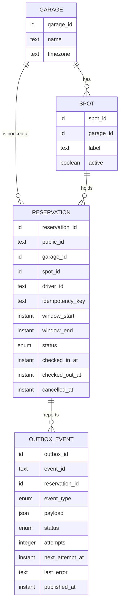

# Data design: parking-reservation
Status: REVIEWED · 2026-11-23
Form: built
Builds on: requirements.md (UC1–UC7, R1–R21, NF1–NF5, LD3)

Four entities: the garage and spot reference data, the reservation with its lifecycle, and an outbox that carries each state change to billing and any later consumer. Double-booking is prevented by the database itself, and every state change plus its event is one atomic statement.

## Logical model

Technical columns `created_at` and `updated_at` are not drawn (physical model).

| Entity | Meaning, ids, invariants |
|---|---|
| E1 garage | Reference data (OI-7). `garage_id` is global. `timezone` is an IANA name; a date is the calendar day in it (R16). |
| E2 spot | Reference data. `spot_id` is global; `label` is unique within its garage (scope: OI-18). `active=false` spots are never assigned. |
| E3 reservation | UC1–UC5. `public_id` is the client-facing reference (global UUIDv7). `driver_id` is an external opaque id (OI-13). Window `[start, end)` (R19, R20), end after start (R5). `idempotency_key` is 1 to 128 characters (the API rejects a longer one as a validation error before the database CHECK). States `booked → checked_in → completed`, `booked → cancelled`; the stamps `checked_in_at`, `checked_out_at`, `cancelled_at` exist exactly in the states that imply them. Only `booked` and `checked_in` hold the spot (R4). |
| E4 outbox_event | UC6. One row per reservation and transition type; `event_id` is what consumers deduplicate on. `pending → published`, or `pending → parked` only when the broker rejects the event as permanently undeliverable; an outage leaves rows `pending`. An operator may re-drive a `published` or `parked` row back to `pending` (clearing `published_at`, resetting `attempts` to 0, `next_attempt_at` now). |

## Access patterns
| Id | Pattern | Rate | Serves |
|---|---|---|---|
| AP1 | find a spot of a garage with no active overlapping reservation, and book it | ≤ 5,000/day (proposed — OI-8), bursts | UC1, R1, R9 |
| AP2 | reservation by `public_id` for its driver | high | UC3–UC5, UC7, R13, R21 |
| AP3 | reservations of a garage overlapping a garage-local date | staff, low | UC2, R16 |
| AP4 | reservation by (`driver_id`, `idempotency_key`) | every reserve | UC1 AC4, R18 |
| AP5 | guarded transition of one reservation | per command | UC3–UC5 |
| AP6 | pending outbox rows whose `next_attempt_at` is due, oldest first | scheduled | UC6 |
| AP7 | garage by id (timezone) | every lookup | UC1 AC6, UC2 |

## Engine family
Relational, Postgres dialect (LD3; product and version pinned in stack selection).

## Physical model
Lives in `migrations/` (tables, indexes, `COMMENT ON` descriptions, the `outbox_payload` function); the comments describe every table and column. Rules the schema carries: the composite foreign key `(spot_id, garage_id)`, the stamp checks that tie `checked_in_at`, `checked_out_at` and `cancelled_at` to the status, `window_end > window_start`, the exclusion constraint of R1, and one outbox row per (reservation, event type). `garage_id` and `spot_id` are what clients see; the out-of-band loader (OI-7) validates `timezone` against `pg_timezone_names`. `public_id` is the reservation id billing receives. The payload's `occurred_at` is the transition's clock value, equal to `reservation.updated_at` afterwards. `outbox.payload` holds the event-catalog fields, built by `outbox_payload` in the statement that changes the state.

## Write paths
| Id | Operation | Idempotency | Atomicity | Queue |
|---|---|---|---|---|
| W1 | reserve (AP1, AP4) | unique (`driver_id`, `idempotency_key`) with `ON CONFLICT (driver_id, idempotency_key) DO NOTHING` | the service (1) reads by key: found → compare garage and window, equal → replay, different → `IDEMPOTENCY_KEY_REUSED`; (2) validates the window (R5–R8, injected clock), so a replay is answered even after its window has started; (3) in one READ COMMITTED transaction takes `pg_advisory_xact_lock(1, garage_id::int)` (contested — OI-22) as its own statement (never inside the booking CTE), which serializes reservations per garage, then runs one statement: pick the lowest free active spot, insert the reservation, insert the `reserved` outbox row (data-modifying CTE); zero rows → a separate read by key (found → the step 1 comparison), then AP7 (missing garage → `GARAGE_NOT_FOUND`), else `GARAGE_FULL` | event via outbox |
| W2 | check in | guarded `UPDATE … WHERE public_id=$id AND driver_id=$caller AND status='booked' AND $now >= window_start AND $now < window_end`; zero rows → separate re-read by `public_id` and `driver_id`: missing or foreign → `NOT_FOUND`, `checked_in` → replay, `booked` outside the window → `OUTSIDE_WINDOW`, else `ILLEGAL_TRANSITION` (R10, R13) | one statement: update plus `checked_in` outbox row | event via outbox |
| W3 | check out | guarded `UPDATE … WHERE public_id=$id AND driver_id=$caller AND status='checked_in'`, stamping `checked_out_at` and `updated_at` with the later of the clock and `checked_in_at` so the stay is never negative across instances; zero rows → separate re-read: missing or foreign → `NOT_FOUND`, `completed` → replay, else `ILLEGAL_TRANSITION` (R11, R13) | one statement: update plus `completed` outbox row | event via outbox: billing is told (R14) |
| W4 | cancel | guarded `UPDATE … WHERE public_id=$id AND driver_id=$caller AND status='booked'`; zero rows → separate re-read: missing or foreign → `NOT_FOUND`, `cancelled` → replay, else `ILLEGAL_TRANSITION` (R12, R13) | one statement: update plus `cancelled` outbox row | event via outbox |
| W5 | relay publish | `UNIQUE (reservation_id, event_type)` allows one event per transition; consumers deduplicate on `event_id` | per row, one short transaction: claim one row `FOR UPDATE SKIP LOCKED` where `status='pending'` and `next_attempt_at <= $now`, publish and await the result, then mark `published` and commit; a transient failure raises `attempts` and moves `next_attempt_at` out, a rejection of that one event as invalid or oversize sets `parked`; an operator may re-drive a `published` or `parked` row to `pending` with `published_at` cleared, `attempts` 0 and `next_attempt_at` now (AD10) | the publish itself is the queue hop |

The outbox insert in W1–W4 is a plain insert that sets `next_attempt_at = $now`, so a violated uniqueness would abort the state change rather than lose its event; a guarded update matches only the first time, so a second event row cannot arise. W1 alone enforces `spot.active` (the pick filters on it) and the window rules R6–R8; the schema enforces R5 only.

## Index / key plan
In `migrations/0001-create-tables.sql` and `0002-create-indexes.sql`. Each index serves an access pattern: the exclusion constraint serves R1 and the AP1 overlap probe, `reservation_garage_window_idx` serves AP3, the unique (`driver_id`, `idempotency_key`) serves AP4 and the ops lookup by driver, unique `public_id` serves AP2, `outbox_pending_idx` serves AP6, `outbox_reservation_idx` serves ops lookups.

## Decisions
| Id | Decision | By | Why | Beat | Serves |
|---|---|---|---|---|---|
| DD1 | Relational Postgres | agent | spot exclusion and multi-row invariants; Postgres fixed by LD3; Cloud Run reaches it through a small pool | document store | R1, LD3 |
| DD2 | No double-booking by an exclusion constraint on (spot, window) over active statuses | agent | the database refuses the second writer whatever the application does | an application-level check or lock as the only guard (DD5 adds a lock for liveness) | R1, R3, R4 |
| DD3 | Bigint identity primary keys plus a UUIDv7 `public_id` | agent | insert locality internally; the public reference is non-enumerable and generated outside the database | UUID primary key | R13, R21 |
| DD4 | The service picks the lowest free active `spot_id` | agent | deterministic and testable | random spot | R9 |
| DD5 | Reservations of one garage are serialized by a transaction-scoped advisory lock taken just before the booking statement; the exclusion constraint stays as the backstop, and a violation under the lock is a defect surfaced as a technical error | agent | the booking statement's snapshot is taken after the lock wait, so it sees every earlier commit: no spot is refused while free and no retry loop exists; volume (NF2) makes serializing harmless | exclusion-constraint race with bounded retry, row locks with `SKIP LOCKED` (both refuse or fail requests while spots are free) | R1, UC1 AC1–AC3 |
| DD6 | Each transition writes its event in the same statement | agent | no state change without its event, no event without its state change | publish in the request path | R14, UC6 |
| DD7 | One outbox row per (reservation, event type) | agent | one completion never produces two notices | event log keyed only by id | UC6 AC3 |
| DD8 | A retried command on a reservation already in its target state is answered from the stored row, not as an error | agent | the client retrying after a lost response is expected | reject as illegal transition | UC3–UC5 |
| DD9 | Day boundaries are computed in the database from `garage.timezone` | agent | one trip; correct across daylight-saving changes | convert in the application | R16 |
| DD10 | `driver_id` is a plain text column | agent | external identity, no foreign key across systems | local driver table | NF4 |
| DD11 | `timestamptz` everywhere; business timestamps come from the injected clock and are passed as parameters | agent | one representation, testable time | `now()` in SQL | R5, R6 |
| DD12 | Each business-state transition of a reservation gets an outbox row (DD6), though billing needs only `completed` | agent | publishing every transition is the default and a later consumer needs no schema change, and the retained outbox rows can be re-driven to it (event catalog in phase 2) | outbox for `completed` only | UC6 |

## Schema evolution
Numbered files in `migrations/`, additive first, applied once each by `python -m parking_reservation.migrate` (bookkeeping table `schema_migration`, outside this model). `btree_gist` must be available on the target Postgres.
