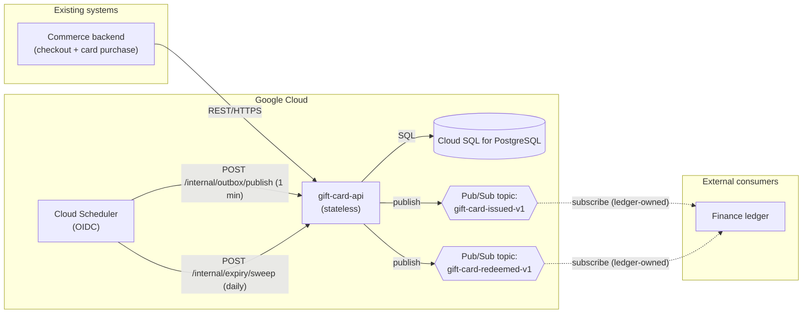
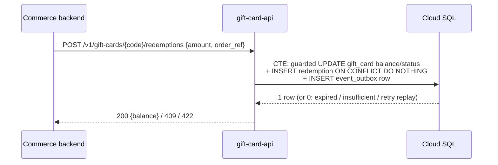

# Gift-Card Service — Architecture Design

Status: APPROVED by user 2026-08-14.

Source: `requirements.md`, `data-design.md`.

## Service split

One service, `gift-card-api`, per requirements LD3: a single entity
family (card → redemptions) with one owning team, no separately scaled
hot path, and no consumer needing an independent deploy cadence. The
scheduled expiry sweep and outbox publisher are internal endpoints of
the same service, triggered by Cloud Scheduler — not separate services.

## Component diagram

## Sequence — UC2 redeem at checkout

## Decisions table

| Service | Stateless/Stateful | Cache | Deployment target |
|---|---|---|---|
| `gift-card-api` | Stateless — all mutable state in Cloud SQL; the scheduled endpoints are stateless too (outbox rows claimed via `FOR UPDATE SKIP LOCKED`, expiry sweep is a guarded `UPDATE`) | None — balance reads must be fresh (a stale cached balance breaks checkout), and no other read is hot | **Cloud Run** — traffic is spiky, holiday/flash-sale-driven with near-zero overnight and off-season idle (NF2); scale-to-zero fits, and no sustained-throughput or pull-consumer need argues for Kubernetes |

| Interaction | Sync/Async | Protocol | Failure path |
|---|---|---|---|
| Commerce backend ↔ API (`/v1/*`) | Sync | REST/HTTPS (JSON) | Client retries on timeout/5xx. Redeem dedupes on `(gift_card_id, order_ref)` (data-design write-path #2) — a retry applies once or returns the original outcome, never a double charge. |
| API → Cloud SQL | Sync | SQL, one round trip per write path (per data-design) | A failed transaction leaves no partial state — every write path is a single statement or single CTE. |
| Cloud Scheduler → `/internal/outbox/publish` | Async relay, every 1 min | HTTPS POST, OIDC-authenticated | **The schedule is the retry**: each run re-scans `WHERE published_at IS NULL`. Poison rows are isolated (`FOR UPDATE SKIP LOCKED`, one publish per row — no head-of-line blocking); rows stuck past `attempt_count >= 5` raise a log-based Cloud Monitoring alert. No DLQ table at this size — ops inspects the flagged row. |
| Cloud Scheduler → `/internal/expiry/sweep` | Async, daily | HTTPS POST, OIDC-authenticated | The guarded `UPDATE` is idempotent — a missed or doubled run converges to the same state on the next run. |
| API (publisher) → Pub/Sub | Async via outbox | Pub/Sub publish (client library) | Publish failure leaves `published_at` null and increments `attempt_count`/`last_error`; retried next scheduled run. |
| Pub/Sub → Finance ledger | Async | Subscription owned by the ledger team | At-least-once delivery; the ledger dedupes on the payload's `order_ref` (redemptions) / `code` (issuance). This service's obligation ends at a successful publish. |

## API inventory

| Endpoint | Purpose | Consumer | Sync/Async |
|---|---|---|---|
| `POST /v1/gift-cards` | UC1 — issue a card | Commerce backend | Sync |
| `POST /v1/gift-cards/{code}/redemptions` | UC2 — redeem against an order | Commerce backend | Sync |
| `GET /v1/gift-cards/{code}` | UC3 — balance and expiry lookup | Commerce backend (on the shopper's behalf) | Sync |
| `POST /internal/expiry/sweep` | UC4 — expire overdue active cards | Cloud Scheduler only (OIDC-restricted) | Sync trigger of a guarded batch update |
| `POST /internal/outbox/publish` | Claim and publish unpublished `event_outbox` rows | Cloud Scheduler only (OIDC-restricted) | Sync trigger of an async hand-off |
| `GET /healthz` | Liveness/readiness | Platform | Sync |

## Event catalog

| Topic | Triggering transition | Payload sketch | Known consumers | Versioning |
|---|---|---|---|---|
| `gift-card-issued-v1` | card created (UC1) | `{ "code": "<text>", "initial_amount": <numeric>, "issued_at": "<rfc3339>" }` | Finance ledger | Breaking payload change → new topic `-v2`; additive fields are non-breaking |
| `gift-card-redeemed-v1` | redemption recorded (UC2) | `{ "code": "<text>", "amount": <numeric>, "order_ref": "<text>", "redeemed_at": "<rfc3339>", "redeemed_channel": "<text>" }` | Finance ledger | Breaking payload change → new topic `-v2`; additive fields are non-breaking |

## Scaling notes

- Cloud Run scales `gift-card-api` horizontally on request volume;
  stateless design means no session affinity.
- Cloud SQL is the single write bottleneck by design (the guarded
  balance decrement serializes per card) — a non-issue at NF3's scale;
  two shoppers racing on the *same* card code is the only contention
  point and is exactly what the guard must serialize.
- The outbox publisher processes a bounded batch (`LIMIT 100`) per
  invocation; if a holiday burst outruns the 1-minute cadence, tighten
  the schedule before adding infrastructure.
