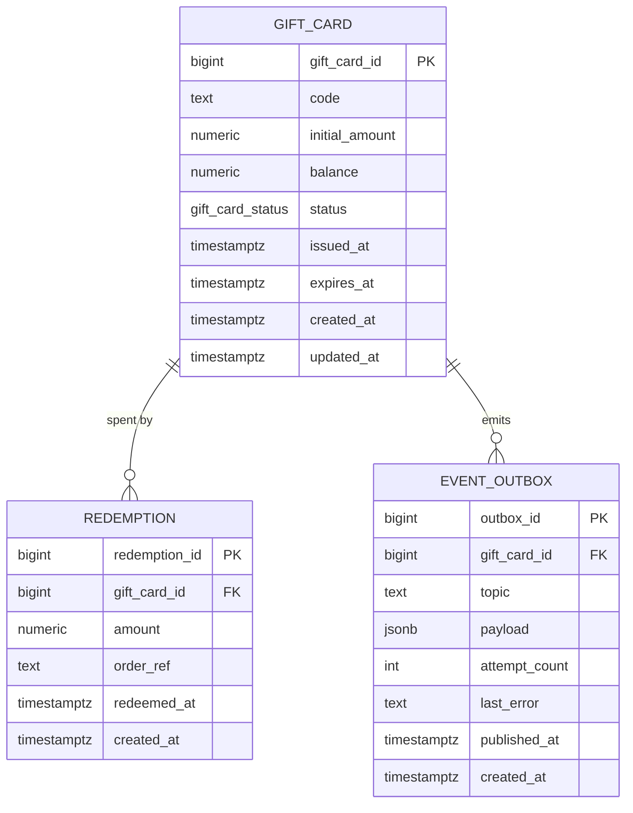

# Gift-Card Service — Data Design

Status: APPROVED by user 2026-08-14.

Source: `requirements.md` (UC1–UC4, R1–R5).

## Entity model

### Rationale per table

**`gift_card`** — the core entity. `status` is a native Postgres enum
(`gift_card_status`: `active`, `redeemed`, `expired`) — the value set is
small and fixed by the lifecycle in requirements (a card is `active`
until either fully spent, AC2.5, or past expiry, UC4). `expires_at` is
stamped at issuance as `issued_at` + 12 months (LD1) so the redeem guard
and the expiry sweep compare against a stored column instead of
re-deriving the policy. `balance` carries a `CHECK (balance >= 0)` so R2
holds even against a buggy write path.

**`redemption`** — append-only record of each spend (R4). `order_ref` is
the commerce backend's order reference; unique per card (see index
plan), which is what makes AC2.3's retry-safety mechanical.

**`event_outbox`** — transactional outbox for R5: the ledger
notification row is written in the same transaction as the state change
it reports, then a scheduled publisher delivers unpublished rows to
Pub/Sub and stamps `published_at`. `payload` is the exact event JSON
(schema per the architecture event catalog); `attempt_count`/`last_error`
make stuck rows observable and alertable.

## Engine decision

**PostgreSQL** (Cloud SQL for PostgreSQL — GCP per requirements §8).
The domain is relational (card → redemptions) with real integrity needs:
R1 wants a database-enforced unique code, R2 an atomic guarded balance
decrement, and AC2.3 a uniqueness guarantee under concurrent retries —
all natural in Postgres, none with a document-DB equivalent worth the
trade. No access pattern here argues for a document store.

## Write-path table

| # | Operation (use case) | Idempotency mechanism | Atomicity mechanism | Queue decision |
|---|---|---|---|---|
| 1 | Issue card (UC1) | Code generation retried on unique-violation of `uq_gift_card_code` (regenerate, bounded attempts). No client idempotency key — the commerce backend calls once per purchased card (its own order flow dedupes). | One data-modifying CTE: `INSERT` the card + `INSERT` the `gift-card-issued-v1` outbox row, single round trip, one transaction. | Outbox → Pub/Sub (ledger notification, R5). |
| 2 | Redeem (UC2) | `INSERT` into `redemption` guarded by unique `(gift_card_id, order_ref)` with `ON CONFLICT DO NOTHING` — a checkout retry inserts zero rows and the card update is skipped with it (AC2.3, R4). | One data-modifying CTE: guarded `UPDATE gift_card SET balance = balance - $amt, status = CASE WHEN balance - $amt = 0 THEN 'redeemed' ELSE status END WHERE code = $code AND status = 'active' AND expires_at > now() AND balance >= $amt` + the `redemption` insert + the `gift-card-redeemed-v1` outbox row. Zero rows updated ⇒ rejected (expired / insufficient / not active), app re-reads to pick the right error. Single round trip. | Outbox → Pub/Sub (ledger notification, R5). |
| 3 | Balance check (UC3) | N/A (read). | N/A (read). | N/A. |
| 4 | Expiry sweep (UC4) | Guarded `UPDATE gift_card SET status = 'expired' WHERE status = 'active' AND expires_at <= now()` — idempotent by the guard; a re-run matches zero rows. | Single `UPDATE`, single round trip. | No queue — scheduled invocation (see architecture). |
| 5 | Publish ledger events (background) | Publisher claims rows `WHERE published_at IS NULL ... FOR UPDATE SKIP LOCKED`, publishes, stamps `published_at`. Redelivery-safe: a crash between publish and stamp re-publishes; the ledger dedupes on the event payload's order reference / code. | Claim-then-stamp; the only durable side effect is the stamp. | This is the queue hand-off (outbox → Pub/Sub). |

## Index plan

| Index | Serves |
|---|---|
| `uq_gift_card_code` unique on `gift_card(code)` | R1/LD2 — global code uniqueness; also the lookup path for redeem and balance check (UC2/UC3). |
| `uq_redemption_card_order` unique on `redemption(gift_card_id, order_ref)` | AC2.3/R4 — at most one redemption per card per order reference. |
| `idx_gift_card_active_expiry` partial on `gift_card(expires_at) WHERE status = 'active'` | UC4 — the expiry sweep scans only active cards. |
| `idx_redemption_gift_card` on `redemption(gift_card_id)` | Redemption history per card (support/debug path). |
| `idx_event_outbox_unpublished` partial on `event_outbox(created_at) WHERE published_at IS NULL` | Publisher poll (write-path #5). |

## Schema evolution notes

- Migrations live under `ddl/` as numbered, per-concern files:
  `01-create-tables.sql`, `02-create-indexes.sql`. Future changes add a
  new numbered file rather than editing history.
- Additive-first: if refunds-onto-cards ever enter scope (requirements
  §9), the additive change is a signed-amount or `refund` row kind on
  `redemption`, not a redesign of `gift_card`.
