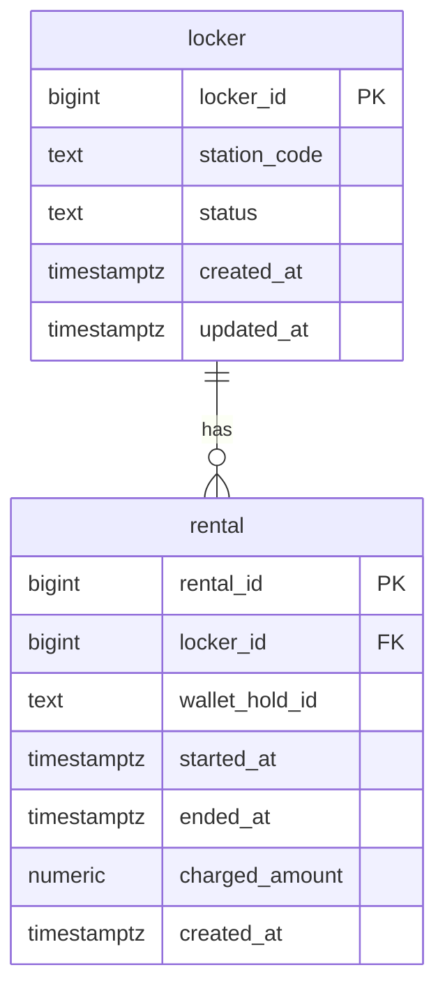

# Data design: locker-rental service

Status: APPROVED · 2026-08-14 · approved by Dana Reyes
Form: design
Builds on: requirements.md (UC1–UC2, R1–R3)

Source: `requirements.md` (UC1–UC2, R1–R3).

## Entity model

## Write-path table

| Id | Operation | Idempotency | Atomicity |
|---|---|---|---|
| W1 | rent | partial unique index: one active rental per locker | fn: insert rental + locker status, one trip |
| W2 | end rental | guarded update WHERE ended_at IS NULL | fn: end + charge record, one trip |
