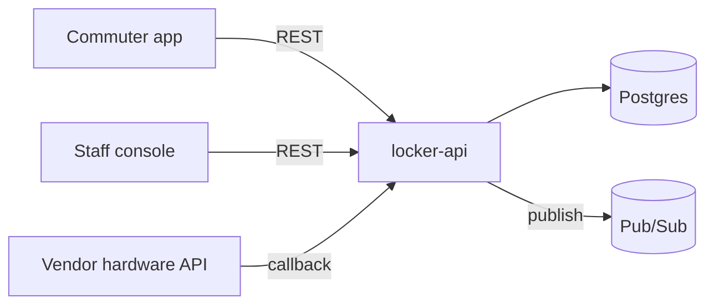
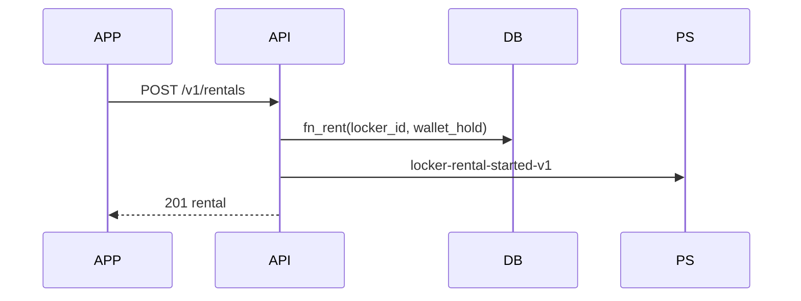

# Architecture design: locker-rental service

Status: APPROVED · 2026-08-14 · approved by Dana Reyes
Form: design
Builds on: requirements.md (UC1–UC2, NF1–NF2), data-design.md

Source: `requirements.md`, `data-design.md`.

## Component diagram

## Key flow

## Decisions table

| Service | State | Cache | Deployment target |
|---|---|---|---|
| locker-api | stateless; state in Postgres | station/locker list, invalidate-on-write | Cloud Run, min-instances=1 |

## Event catalog

| Topic | Trigger | Consumers |
|---|---|---|
| locker-rental-started-v1 | rent success | analytics (future) |
| locker-rental-ended-v1 | end success | wallet reconciliation |
